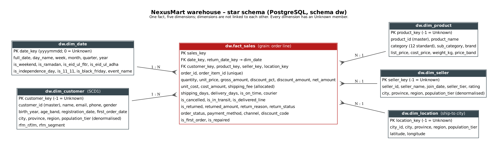

# NexusMart Data Analytics Module – CODE//CONNECT'26

An automated, end-to-end pipeline that takes NexusMart's nine raw CSV files, profiles them, cleans them with documented rules, loads them into a PostgreSQL star schema with Apache Airflow, and feeds a Power BI dashboard and an executive summary.

```
raw CSV ─► Airflow DAG ─► Python cleaning (reject tables + DQ log) ─► PostgreSQL stg ─► star schema dw ─► quality gates ─► Power BI / insights
```

## 1. Repository layout
| Path | What it is |
|---|---|
| `dags/nexusmart_pipeline.py` | Airflow DAG: `extract → validate_raw → clean → load_staging → build_dimensions → build_fact → quality_checks` |
| `pipeline/` | Python package the DAG calls: `config.py` (env-driven settings and thresholds), `normalize.py` (parsers and label dictionaries), `clean.py` (all cleaning rules), `dq.py` (DQ log and reject writer), `db.py` (DB access), `tasks.py` (the 7 tasks and 16 quality checks) |
| `sql/01_staging_ddl.sql` | `stg` and `dq` schemas (staging, DQ log, reject table, task log, check results) |
| `sql/02_dw_ddl.sql` | Star schema DDL: `fact_sales` and 5 dimensions with FK constraints |
| `sql/03_build_dimensions.sql` | Idempotent dimension upserts (SCD1 customer, RFM, event-aware date dimension, Unknown members) |
| `sql/04_build_fact.sql` | FactSales build (returns aggregated per line, shipping fee allocated per line) |
| `sql/06_marts.sql` | Metric views (`mart.v_order_lines`, `mart.v_kpi_monthly`, `mart.v_seller_scorecard`) |
| `sql/07_business_questions.sql` | SQL for every business question in section 10 |
| `scripts/run_pipeline.py` | Runs the same 7 tasks without Airflow (for debugging) |
| `scripts/answer_questions.py`, `build_dq_report.py`, `build_exec_summary.py` | Regenerate `reports/` |
| `docs/star_schema.png / .pdf` | Data model diagram |
| `reports/data_quality_report.md` | Before/after counts and every rule with its row count |
| `reports/executive_summary.pdf` | 2-page executive summary and business insights |
| `reports/answers/*.csv` | The figure behind every answer |
| `powerbi/` | `measures.dax`, `nexusmart_theme.json`, `BUILD_GUIDE.md` (and `NexusMart.pbix` once built) |
| `data/raw/` | The nine source CSVs, untouched |
| `data/work/` | Generated on each run: raw snapshot, clean files, rejects, DQ logs (git-ignored) |

## 2. How to run (judges)
Prerequisites: Docker Desktop (4 GB RAM or more for Docker).

```bash
cp .env.example .env            # Linux: also set AIRFLOW_UID=$(id -u) in .env
docker compose up -d --build    # first build ~3-5 min
```
1. Open **http://localhost:8080** and log in as `admin` / `admin`.
2. The DAG `nexusmart_pipeline` is unpaused and scheduled `@daily`. Trigger it with ▶ for an immediate run. A full run takes about 2 minutes.
3. All 7 tasks turn green. Run it again to confirm idempotency: row counts and surrogate keys stay the same.
4. The warehouse is at `localhost:5433`, database `nexusmart_dw`, user/password `nexus`/`nexus`.

```sql
SELECT * FROM dq.task_log ORDER BY logged_at DESC;        -- rows read / rejected / loaded per task
SELECT * FROM dq.quality_results ORDER BY checked_at DESC; -- 16 checks, PASS/FAIL
SELECT * FROM dq.rejects LIMIT 50;                         -- quarantined records with reason codes
SELECT * FROM mart.v_kpi_monthly ORDER BY year_month;
```
Regenerate the reports after a run (from the host, against port 5433):
```bash
pip install -r requirements.txt reportlab
export NEXUS_DB_PORT=5433
python scripts/answer_questions.py && python scripts/build_dq_report.py && python scripts/build_exec_summary.py
```
Without Docker (any PostgreSQL 13+): set `NEXUS_DB_HOST/PORT/NAME/USER/PASSWORD`, `pip install -r requirements.txt`, then `python scripts/run_pipeline.py`.

**Pipeline requirements in the brief, and how each is met**
* *Config outside code*: file paths and DB credentials come from environment variables (`.env` → docker-compose). Airflow Variables with the same names (`NEXUS_RAW_DIR`, `NEXUS_DB_HOST`, …) override them.
* *Idempotent*: staging is truncated and reloaded; dimensions are upserted on natural keys, so surrogate keys stay stable; the fact is rebuilt in a single transaction; DQ tables are written per `run_id` with delete-then-insert.
* *Retries*: 2 retries with exponential back-off and a 30-minute timeout. `validate_raw` and `quality_checks` have 0 retries because a data failure will not fix itself on retry.
* *Fail on thresholds*: `validate_raw` fails on missing files or columns, or on more than 1% conflicting keys. `clean` fails if more than 5% of order lines are rejected. `quality_checks` fails the run if any critical check fails (row reconciliation, grain uniqueness, null FKs, revenue/refund/shipping reconciliation, negative amounts, refund ≤ line value, dates inside the window, Unknown-member share ≤ 2%, exactly 12 categories, unique customer masters).
* *Logging*: each task writes rows read, rejected and loaded to `dq.task_log` and the Airflow log.

## 3. Data model


* **FactSales** has one row per order line (314,909 rows). It holds the measures listed in the brief plus `shipping_days`, `delivery_days`, `is_on_time`, `courier`, `is_first_order`, `is_repaired`. Order status, payment method, channel and discount code are kept on the fact as degenerate attributes, so no sixth dimension is needed and dimensions never link to each other.
* **Returns** are aggregated to one row per order line *before* the join, using valid (non-Rejected) returns only, so the grain cannot break.
* **Shipping fee** is charged once per order. It is allocated to lines by their share of the order's gross value, so line fees add back exactly to the order fee (this is a quality check).
* **DimDate** carries flags for weekend, Ramadan, Eid-ul-Fitr, Eid-ul-Adha, 14 August, 11.11 and Black Friday, plus an `event_name` column (from the calendar in the brief).
* **DimCustomer** is SCD Type 1: an upsert overwrites changed attributes. It holds the master customer after de-duplication, denormalised geography, `first_order_date` (for new vs returning) and RFM scores and segment.
* Every dimension has an **Unknown** member (`-1`; date `0`). Fact rows with a missing or invalid reference point to it, so no fact row is dropped for a broken reference.

## 4. Metric definitions (as in the brief)
| Metric | Definition used |
|---|---|
| NMV | Σ(qty × unit price − discount) on non-cancelled lines (In Transit included) |
| Net Revenue | NMV − refunds from valid (non-Rejected) returns |
| Return rate | lines with a valid return ÷ delivered lines (non-cancelled, not In Transit) |
| Cancellation rate | cancelled orders ÷ all orders after duplicate removal |
| COGS / Margin | cost_price × qty on kept lines (non-cancelled, no valid return); Margin = Net Revenue − COGS |
| AOV | NMV ÷ non-cancelled orders |
| Active customers | distinct (de-duplicated) customers with at least one non-cancelled order |
| On-time delivery | delivered within **5 days of order date**. This is about the 70th percentile of observed delivery time and matches the usual 3–5 working-day intercity courier promise. |
| Seller quality score | 35% revenue + 25% (1 − return rate) + 25% on-time rate + 15% (1 − cancellation rate). Each part is a percentile rank among sellers with at least 100 lines, so one part cannot dominate because of its scale. Revenue gets the highest weight because it reflects scale and customer demand. Returns and on-time delivery get equal weight as the two experience measures. Cancellations get less weight because they are partly customer-driven (COD refusal). |
| RFM | R = quintile of days since last order (to 30 Jun 2025). F = order-count bands 1 / 2 / 3–4 / 5–8 / 9+ (fixed bands, because quintiles split ties arbitrarily). M = quintile of NMV. Segments: Champions, Loyal, Potential Loyalists, New, At Risk, Hibernating, Need Attention. |

## 5. Cleaning rules (summary – full list with row counts in `reports/data_quality_report.md`)
Cleaning is implemented in `pipeline/clean.py`; every rule writes a row to the DQ log. **Unrepairable records go to `data/work/rejects/*.csv` and `dq.rejects` with a reason code. Nothing is silently deleted.**

| Issue | Rule |
|---|---|
| Exact duplicate rows | Removed (orders 3,200; payments 3,296) and logged |
| Duplicate customers (2,500) | Candidates share a normalised email **or** phone. They merge only when the normalised name also matches **and** at most one of {other contact, birth year, city} conflicts. Name alone is never a match: 61 candidate pairs with the same name but different details stayed separate. The lowest ID becomes master; `customer_id_map` re-points all 3,582 affected orders. |
| Duplicate products (56) | Same normalised name (case and "(2024)" suffix removed) **and** same brand **and** same weight **and** list price within 10%. Lowest ID becomes master; `product_id_map` re-points order lines. |
| Categories (62 spellings) | Dictionary mapped to the 12 canonical categories, with the sub-category prefix as a fallback. A quality check enforces exactly 12. |
| Labels (status, channel, payment, courier, tier, province, gender, return reason/status) | Normalised key (lower-case, punctuation stripped) → dictionary. Unseen variants become Unknown and are counted, which keeps the pipeline safe for the next data drop. |
| Dates (`yyyy-mm-dd`, `dd/mm/yyyy`, `Mon d yyyy`) | Multi-format parser; slash dates are day/month/year. |
| Invalid order dates (1,124 impossible such as 2024-02-30 or 00/00/2024; 481 outside the window) | Repaired from the first prepaid payment date (equal to the order date 98.4% of the time), else shipped date − 1. 1,505 were repaired; 100 could not be repaired and were quarantined with their lines. |
| Money as text (`Rs. 2,290`) | Parsed to numeric |
| Unit price errors | Compared with the product's median price in the same month: ×100 entries (paisa) are divided by 100, ≈1/280 entries (USD) are multiplied by 280, negatives are made positive. Placeholders (9,999,999 / 0) are **solved exactly from order_total** (order_total = Σ qty × price × (1 − disc%), which holds for 99.6% of clean orders), else imputed from the month median. |
| Quantity errors (words, `2.0`, negatives, 500) | Converted; negatives made positive. The 500s are solved from order_total (630 of 641); 11 lines that could not be solved were rejected. |
| Line discounts (10% missing, 881 inconsistent such as 130% of gross) | Recomputed from the order's discount code %, the authoritative source per the brief (it matches 99.4% of clean lines). |
| order_total placeholders and negatives | Replaced with the sum of the repaired line net values; the source value is kept in `source_order_total`. |
| Product cost (missing, or ≥ list price) | Duplicate partner's cost, else list price × the category's median cost/list ratio; flagged `cost_imputed` |
| Unknown product IDs on order lines (932) | Line kept (the revenue is real) → ProductKey −1; cost = price × the global median cost ratio |
| Missing ship city | Customer's registered city, else Unknown. Missing customer city → that customer's most frequent ship city. |
| Lat/long swapped; province missing | Swapped back; province taken from the nearest city in the same region |
| Shipping: delivered before shipped / transit > 30 days | Swapped / delivered date set to NULL (excluded from delivery-time metrics) |
| Shipping fee missing, 0 or > 10,000 | Courier median; flagged `fee_imputed` |
| Refund > line value | Capped at line net value; Rejected/Declined returns → refund 0 and excluded |
| Orphans (returns without an order line, children of rejected orders) | Rejected with a reason code |

## 6. Design decisions
* **Python does the cleaning, SQL does the modelling.** Cleaning needs cross-table repair logic (e.g. solving a corrupt price from order_total), which is clearer and testable in pandas. Dimensional modelling stays in SQL so judges can read it.
* **Repair before reject.** Most corruptions had an independent source of truth (order_total, discount code, payment date, the product's price history). The order-line reject rate is 0.07%, so revenue totals are not biased by dropping rows.
* **Unknown members instead of dropping.** Fact rows keep their revenue even when a reference is broken. The Unknown share is monitored and is at most 0.3% on every key.
* **Cancelled orders keep their shipping fee**, because a courier was paid for 5,889 of them and the profitability analysis should show that cost.

## 7. Known limitations
* Return rate for the last 1–2 months is understated (Jun-25: 3.98%) because returns for recent orders arrive after the data cut-off.
* Customer de-duplication is rule-based. A duplicate whose email, phone **and** name all changed would not be merged.
* Imputed values (6.2% of shipping fees, 7.4% of product costs, 17 unit prices) are flagged but are still estimates.
* 290 customer IDs on orders do not exist in the customer file. Their orders count toward revenue but map to the Unknown customer, so they are not counted as active customers.
* The DAG was validated structurally and its tasks were run end-to-end against PostgreSQL 16 with `scripts/run_pipeline.py`. The Docker stack uses the official `apache/airflow:2.10.5` and `postgres:16` images.
* The "Hour 6" data drop may contain new label variants. These map to Unknown and appear in the DQ log, and the quality gates (e.g. exactly 12 categories) fail loudly if a new variant changes a business dimension.
